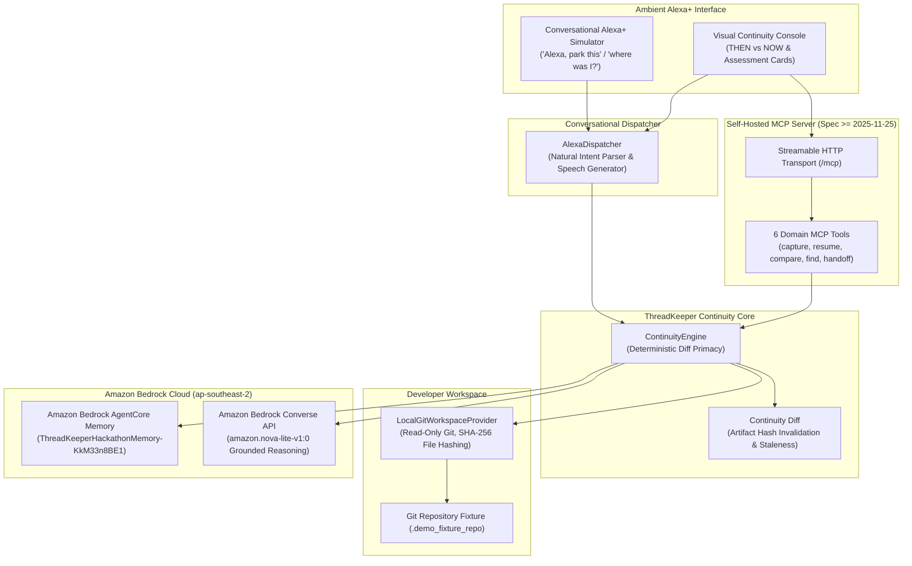

# ThreadKeeper
> Never lose your train of thought.

[](https://www.typescriptlang.org/)
[](https://modelcontextprotocol.io/)
[](https://modelcontextprotocol.io/)
[](https://aws.amazon.com/bedrock/)
[](https://aws.amazon.com/bedrock/agentcore/)
[](LICENSE)

**One-sentence pitch:**  
ThreadKeeper is an Alexa+ continuity agent that captures a developer's working context before an interruption and reconstructs what changed, what became stale, and what to do next when they return.

---

## The Problem: "You don't forget the file. You forget what you were thinking."

Modern software development is fragmented by interruptions: Slack messages, urgent standups, context switches, and lunch breaks.

When a developer steps away from an active investigation:
* **The code editor remembers files.**
* **Git remembers committed history.**
* **AI assistants remember previous conversation transcripts.**
* **Nobody remembers the cognitive state:** the active hypothesis, the rejected attempts, the fragile assumptions, and the next planned step.

When returning 45 minutes later, the developer suffers **interruption fatigue**:
1. *"What was I in the middle of?"*
2. *"Why did I choose this approach over the alternative?"*
3. *"Did someone push code or modify this file while I was away?"*
4. *"Are my earlier assumptions still true, or am I building on invalid premises?"*

---

## The Solution: Cognitive Checkpoints & Continuity Diffs

ThreadKeeper introduces an ambient continuity layer built for voice-first interaction and developer environments:

* **Ambient Cognitive Capture ("Alexa, park this."):** At the moment of interruption, captures a structured **Cognitive Checkpoint**—combining active goals, working decisions, untested assumptions, and direct cryptographic SHA-256 evidence from the local Git workspace.
* **Persistent Cloud Memory:** Stores checkpoints durably in **Amazon Bedrock AgentCore Memory**, surviving local process restarts and machine reboots.
* **Continuity Diff ("Alexa, where was I?"):** Upon return, inspects the current repository state, computes a mathematical diff against the parked baseline, invalidates stale assumptions, and evaluates the semantic impact using **Amazon Bedrock Nova Lite**.
* **Epistemic Trust Model:** Strictly separates verified facts from derived deductions, semantic inferences, and unknowns.
* **Evidence-Grounded Next Action:** Answers with a concise 30-second voice brief and renders an interactive **Visual Continuity Console** displaying THEN vs NOW.

---

## 60-Second Example

1. **Park (Before leaving desk):**  
   Developer is implementing multi-currency payment validation. They say:  
   > 🎙️ *"Alexa, park this."*  
   ThreadKeeper inspects the Git workspace, captures a checkpoint (`cp-1ec1c459`), records the active assumption (*"src/payment.ts accepts currencies without whitelist validation"*), and persists it to AWS AgentCore Memory.

2. **Interruption (While away):**  
   The ThreadKeeper process terminates. While the developer is away, `src/payment.ts` is modified to add a currency whitelist (`["USD", "EUR", "GBP"]`).

3. **Resume (Returning to desk):**  
   A fresh ThreadKeeper process launches with a clean heap. The developer asks:  
   > 🎙️ *"Alexa, where was I?"*  
   ThreadKeeper pulls the checkpoint from AgentCore Memory, reads the current Git state, detects that `src/payment.ts` changed, and speaks:
   > 🔊 *"You were implementing strict multi-currency payment validation with audit logging. While you were away, src/payment.ts changed. That means your previous assumption—that the file accepts currencies without whitelist validation—needs review. I don't yet know whether the issue was fixed or who made the change. Next, inspect the changed currency-validation logic before continuing."*

---

## Why ThreadKeeper is Different

ThreadKeeper is intentionally distinct from existing developer tools:

| Tool Category | What It Does | Why ThreadKeeper is Different |
| :--- | :--- | :--- |
| **Generic Chatbots (ChatGPT / Claude)** | Re-reads chat history; hallucinates current state | ThreadKeeper grounds reasoning in real workspace Git diffs and mathematical evidence. |
| **To-Do Apps (Linear / Jira)** | Static task labels (*"Fix bug"*) | ThreadKeeper captures ephemeral cognitive state: assumptions, evidence IDs, and active decisions. |
| **Note-Taking Apps (Obsidian / Notion)** | Manual manual typing required before leaving | Hands-free ambient voice capture (*"Alexa, park this"*) captures state in < 2 seconds. |
| **Vector Memory RAG Wrappers** | Fuzzy semantic similarity over flat text | Structured graph representation (`Goal -> Decision -> Assumption -> Artifact -> Evidence`). |
| **Git Log / Diff Viewers** | Shows line-by-line syntax diffs | **Continuity Diff:** flags which *mental assumptions* were invalidated by code changes. |

---

## Alexa+ Track Integration

> **Note on Developer Environment:**  
> The web interface serves as a **Simulated Alexa+ Experience powered by live MCP tools**. In compliance with Amazon Hackathon guidelines, official Alexa+ Add-on developer tools (Category SDK, MCP Toolkit, and Web Simulator) are in gated partner preview; participants demonstrate compliance using a self-hosted MCP server and custom conversational simulator.

Voice and ambient interaction represent the natural human interface for continuity:
1. **Zero-Friction Departure:** When a developer is interrupted, they cannot spend two minutes writing handoff notes. Saying *"Alexa, park this"* takes 1.5 seconds and triggers automatic workspace inspection.
2. **Concise Spoken Brief:** Returning developers don't want a wall of text. The 5-sentence spoken brief provides instant orientation in under 20 seconds.
3. **Visual Drill-Down:** The voice brief is mirrored on the **Visual Continuity Console** for deeper inspection of the THEN vs NOW comparison grid.

---

## Model Context Protocol (MCP) Implementation

ThreadKeeper implements a full self-hosted **Model Context Protocol (MCP)** server built strictly to the latest open standards:

* **Protocol Specification:** `MCP >= 2025-11-25`
* **Transport:** **Streamable HTTP** mounted at `/mcp` handling both JSON-RPC 2.0 POST requests and streaming Server-Sent Events (SSE).
* **Self-Contained Gateway:** Fully discoverable by any MCP-compliant client (`tools/list` and `tools/call`).

### Six Registered MCP Tools

```text
POST /mcp
├── capture_checkpoint    -> Ingests workspace context into a validated Cognitive Checkpoint
├── resume_thread         -> Reconstructs context, diffs workspace, returns voice summary
├── compare_current_state -> Computes Continuity Diff against baseline checkpoint
├── find_decision         -> Discovers historical decisions with cited evidence IDs
├── find_unfinished_work  -> Recovers unresolved open questions and blockers
└── create_handoff        -> Generates a lossless JSON handoff packet for coding agents
```

---

## System Architecture



---

## Epistemic Trust Model: Observed, Derived, Inferred, Unknown

ThreadKeeper never presents AI guesses as verified facts. All continuity briefs strictly partition knowledge into four epistemic categories:

```text
┌────────────────────────────────────────────────────────────────────────┐
│                      THREADKEEPER TRUST MODEL                          │
├──────────────────────────────────┬─────────────────────────────────────┤
│ 👁️ OBSERVED FACTS                │ 📐 DERIVED KNOWLEDGE                │
│ Cryptographically verified facts │ Evaluated deterministic logic       │
│ • src/payment.ts modified        │ • The artifact underlying the       │
│ • SHA-256: 5ffebac4c23b...       │   assumption changed; assumption    │
│ • Git working tree dirty         │   marked stale for re-evaluation    │
├──────────────────────────────────┼─────────────────────────────────────┤
│ 💡 INFERRED CONTEXT              │ ❓ UNKNOWNS (GROUNDING BOUNDARY)    │
│ Advisory model interpretation    │ Explicitly unproven assumptions     │
│ • Currency whitelist validation  │ • Who or what authored the changes  │
│   introduced while away          │ • Whether payment integration tests │
│                                  │   pass with the whitelist           │
└──────────────────────────────────┴─────────────────────────────────────┘
```

---

## AWS Cloud Infrastructure (AWS Builder Mini-Challenge)

ThreadKeeper meaningfully integrates AWS services to provide persistent memory and grounded semantic reasoning:

1. **Amazon Bedrock AgentCore Memory:**
   * **Resource Name:** `ThreadKeeperHackathonMemory`
   * **Resource ID:** `ThreadKeeperHackathonMemory-KkM33n8BE1`
   * **Region:** `ap-southeast-2` (Sydney)
   * **Function:** Provides durable, actor-sessionized memory that persists cognitive checkpoints across complete application and process terminations.
   * **Process-Death Continuity:** Proven live across two genuinely independent Node.js processes with clean memory heaps.

2. **Amazon Bedrock Converse API (Amazon Nova Lite):**
   * **Model ID:** `amazon.nova-lite-v1:0`
   * **Region:** `ap-southeast-2`
   * **Function:** Evaluates the semantic implications of modified files under a zero-temperature, strict-schema grounding contract. Rejects hallucinated bug fixes and unsupported causal claims.

---

## Real Git Workspace Integration

* **Non-Mutating Inspection:** Uses read-only `child_process.execFile` argument arrays (no shell expansion) to query Git status, diff-stat, and commit metadata.
* **Deterministic Artifact Hashing:** Computes SHA-256 hashes of tracked source files to detect modifications independently of file timestamps.
* **Security & Secret Exclusion:** Automatically filters out sensitive patterns (`.env*`, `.pem`, `.key`, `id_rsa`, `id_ed25519`, `credentials.json`, `secret*`, `.threadkeeper*`).

---

## Visual Continuity Console Preview

```text
+----------------------------------------------------------------------------------------------------+
|  THREADKEEPER VISUAL CONTINUITY CONSOLE                               [Local Runtime Active] [ap-southeast-2] |
+---------------------------------------------------+------------------------------------------------+
|  AMBIENT ALEXA+ CONTROLS                          |  THEN vs NOW CONTINUITY INSPECTOR              |
|                                                   |                                                |
|  [ Ask Alexa...                          ] [Ask]  |  ⏪ THEN (Baseline Checkpoint cp-1ec1c459)     |
|  ( "Alexa, park this." ) ( "where was I?" )       |  • Goal: Implement multi-currency payment      |
|  ( "what changed?" )   ( "next action?"   )       |  • Assumption: Accepts any currency without    |
|                                                   |               whitelist validation             |
|  DEMO STEPPER:                                    |  • Evidence Hash: sha256-7dbd56ec2...          |
|  [1. Setup] [2. Park] [3. Interrupt] [4. Resume]   |                                                |
|                                                   |  ⏩ NOW (Current Reality)                      |
|  🔊 ALEXA+ SPOKEN RESPONSE:                       |  • Changed Artifacts: src/payment.ts           |
|  "You were implementing strict multi-currency     |  • Status: STALE / NEEDS REVIEW                |
|   payment validation with audit logging. While    |  • Evidence Hash: sha256-5ffebac4c...          |
|   you were away, src/payment.ts changed..."       |                                                |
|                                                   |  🧠 THREADKEEPER GROUNDED ASSESSMENT           |
|  🎯 RECOMMENDED GROUNDED NEXT ACTION:             |  [👁️ Observed]  src/payment.ts changed while away |
|  "Re-evaluate assumption for src/payment.ts       |  [📐 Derived]   Artifact changed; assumption stale |
|   and inspect the changed currency-validation     |  [💡 Inferred]  Currency whitelist logic altered |
|   logic before continuing."                       |  [❓ Unknown]   Who or what authored the changes |
+---------------------------------------------------+------------------------------------------------+
```

---

## Local Setup & Quickstart

### Prerequisites
* Node.js `>= 22.0.0`
* Git `>= 2.39.0`
* (Optional for live AWS) AWS CLI configured with profile `threadkeeper` in `ap-southeast-2`

### Installation
```bash
# Clone the repository
git clone https://github.com/DaRk-plays/Thread_Keeper.git
cd Thread_Keeper

# Install dependencies
npm install

# Build TypeScript to dist/
npm run build
```

### Running the Visual Console & MCP Server
```bash
# Start local server on http://127.0.0.1:3100
npm start
```
* **Visual Continuity Console:** `http://127.0.0.1:3100/`
* **Streamable HTTP MCP Endpoint:** `http://127.0.0.1:3100/mcp`
* **API Health Check:** `http://127.0.0.1:3100/api/health`

---

## Verification Commands

ThreadKeeper includes a comprehensive suite of automated verification runners:

```bash
# 1. Run unit test suite (88 automated tests across 10 suites, 100% offline & deterministic)
npm test

# 2. Run TypeScript compiler typecheck
npm run typecheck

# 3. Run ESLint code quality check
npm run lint

# 4. Verify Real Git Workspace Continuity & Diff Staleness
npm run verify:workspace

# 5. Verify MCP Server & All 6 Tools over Streamable HTTP
npm run verify:mcp

# 6. Verify Visual Web Console & REST Runtime
npm run verify:web

# 7. Verify Live Amazon Bedrock Nova Lite Grounding (AWS credentials required)
npm run verify:bedrock

# 8. Verify Live AgentCore Memory Across Real Process Restart (AWS credentials required)
npm run verify:memory

# 9. Verify Complete 7-Gate Pre-Demo Vertical Slice (AWS credentials required)
npm run verify:demo
```

---

## Interactive 1-Touch Demo Walkthrough

To demonstrate the full vertical slice via command line or web UI:

```bash
# Step 1: Initialize Git fixture repository with initial payment prototype
npm run demo:setup

# Step 2: Simulate "Alexa, park this." -> saves to AWS AgentCore Memory
npm run demo:park

# Step 3: Simulate interruption -> modifies src/payment.ts (working tree dirty)
npm run demo:interrupt

# Step 4: Fresh process starts -> "Alexa, where was I?" -> diffs and speaks
npm run demo:resume
```

---

## AWS Setup & Safety Notes

### Deterministic Local Mode (Default & Zero-Cost)
* ThreadKeeper defaults to **100% offline, deterministic execution** (`THREADKEEPER_MEMORY_PROVIDER=local`, `THREADKEEPER_MODEL_PROVIDER=fixture`).
* Having AWS credentials present on your machine **NEVER silently triggers paid Bedrock or AgentCore calls**. All standard tests, local MCP operations, and web consoles run out-of-the-box without AWS access.

### Optional Live AWS Cloud Mode (Evaluator-Owned)
Judges or developers wishing to test against live AWS infrastructure can supply their own AWS environment:
* **Region:** `ap-southeast-2` (or any Bedrock AgentCore-supported region)
* **Model ID:** `amazon.nova-lite-v1:0` (Amazon Nova Lite via Converse API)
* **AgentCore Memory:** Evaluator's own AgentCore Memory resource ID
* **Configuration:**
  ```bash
  export AWS_REGION=ap-southeast-2
  export AWS_PROFILE=your-profile
  export THREADKEEPER_MEMORY_PROVIDER=agentcore
  export THREADKEEPER_AGENTCORE_MEMORY_ID=your-agentcore-memory-id
  export THREADKEEPER_MODEL_PROVIDER=bedrock
  export BEDROCK_MODEL_ID=amazon.nova-lite-v1:0
  ```
* Evaluators are never required or expected to access the author's private AWS account.

### Cost & Safety Contract
* **No always-on compute infrastructure was provisioned.**
* **Usage remains intentionally minimal.**
* **Exact billed consumption will be confirmed after AWS billing settles.**

---

## Project Structure

```text
Thread_Keeper/
├── .agents/skills/          # Modular agentic capability playbooks
│   ├── aws-agentcore/       # AWS Bedrock & AgentCore operations
│   ├── mcp-alexa/           # MCP protocol & Streamable HTTP rules
│   ├── product-guardian/    # Continuity product guardrails
│   ├── submission/          # Devpost, demo script & hackathon rules
│   └── verification/        # Truth discipline & test gates
├── docs/                    # Authoritative documentation brain
│   ├── ARCHITECTURE.md      # Architectural contracts & fallbacks
│   ├── AWS_COST_NOTES.md    # Cost ledger & bounding rules
│   ├── AWS_RESOURCES.md     # Active AWS cloud infrastructure ledger
│   ├── DECISIONS.md         # Architecture Decision Records (ADRs)
│   ├── DEMO_SCRIPT.md       # Exact 2:40 video script & storyboard
│   ├── DEVPOST_SUBMISSION.md# Complete Devpost project submission copy
│   ├── FRICTION_LOG.md      # Amazon developer experience friction log
│   ├── HACKATHON_SOURCE_OF_TRUTH.md # Verified competition snapshot
│   └── STATUS.md            # Implementation reality & proven milestones
├── src/
│   ├── alexa/               # Alexa+ conversational dispatcher & intent parser
│   ├── cli/                 # Deterministic verification & demo runners
│   ├── domain/              # Zod schemas & epistemic grounding models
│   ├── engine/              # Continuity Engine & Continuity Diff calculator
│   ├── mcp/                 # Self-hosted MCP Server (Streamable HTTP)
│   ├── providers/           # Provider implementations (Memory, Model, Workspace)
│   └── web/                 # Express server & Visual Continuity Console UI
├── tests/                   # 88 automated unit & integration tests
├── LICENSE                  # MIT License
├── package.json             # Scripts & dependency definitions
└── tsconfig.json            # Strict TypeScript configuration
```

---

## Hackathon Build Scope & Tracks

* **Primary Track:** **Alexa+**  
  * Self-hosted MCP server implementing MCP spec `>= 2025-11-25` over Streamable HTTP (`/mcp`).
  * Ambient voice dispatcher with natural conversational cadence.
  * Simulated Alexa+ Visual Continuity Console.
* **Mini-Challenge:** **AWS Builder**  
  * Deep, genuine integration of **Amazon Bedrock AgentCore Memory** for process-death persistent context.
  * Deep integration of **Amazon Bedrock Converse API** (`amazon.nova-lite-v1:0`) for strictly grounded semantic reasoning.
* **Developer Friction Log:**  
  * Comprehensive developer experience friction log maintained at [`docs/FRICTION_LOG.md`](docs/FRICTION_LOG.md) for the optional 10% judging bonus.

---

## License

This project is licensed under the **MIT License** — see the [LICENSE](LICENSE) file for details.
